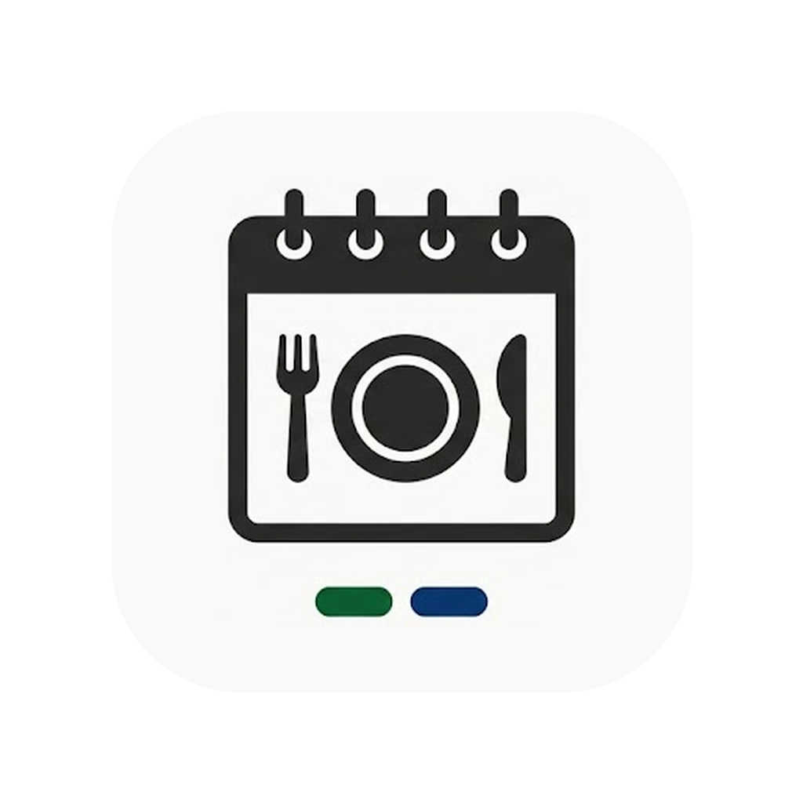
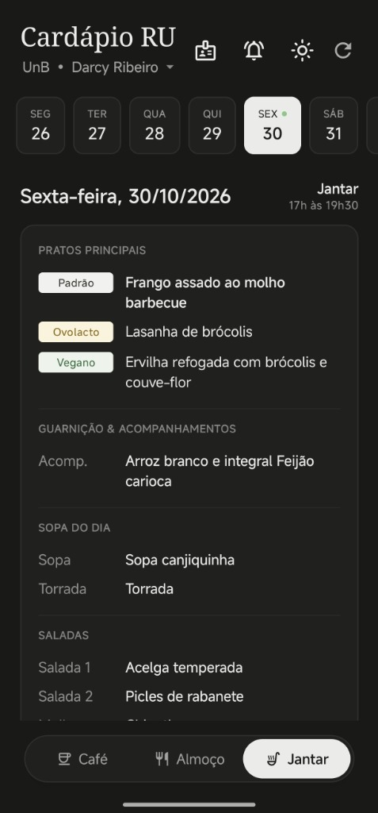
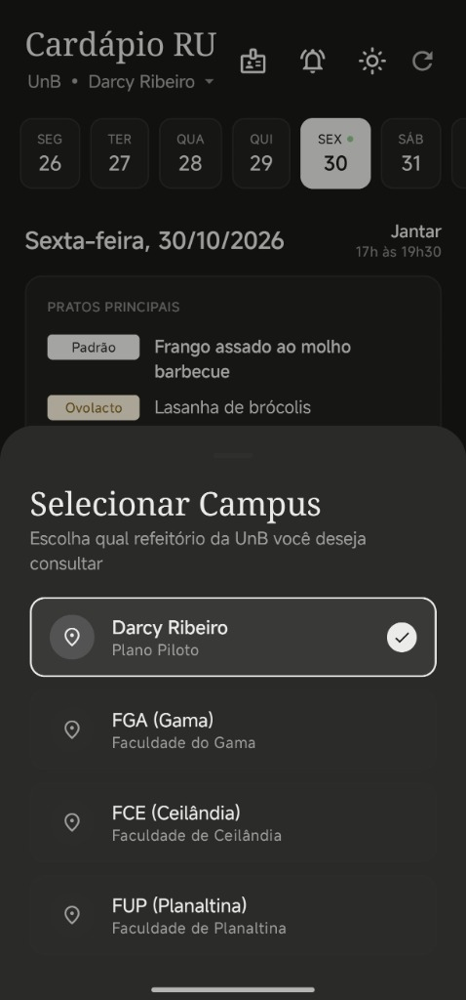
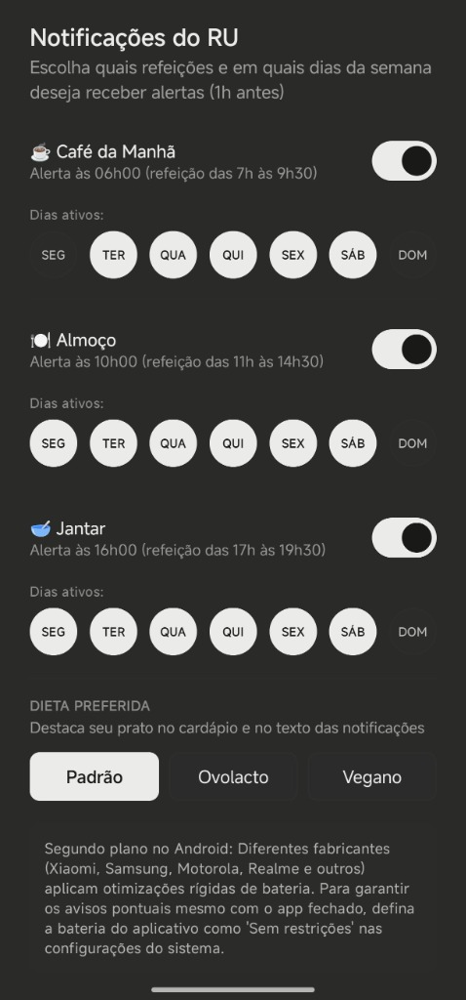
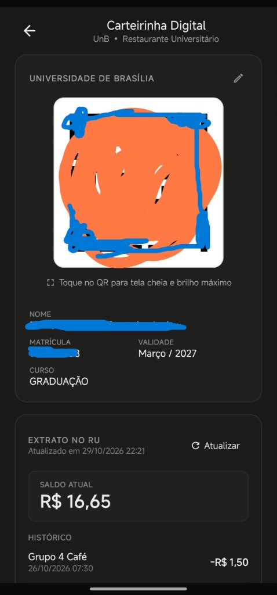
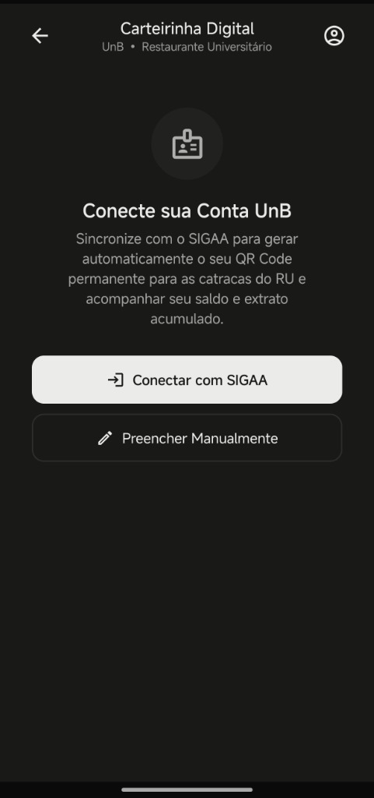

<p align="center">
  
</p>

<h1 align="center">RU UnB</h1>

<p align="center">
  <a href="https://github.com/Cl0udShifter/ru-unb-cardapio/releases/latest"></a>
  <a href="https://cl0udshifter.github.io/ru-unb-cardapio/"></a>
  <a href="obtainium://add/https://github.com/Cl0udShifter/ru-unb-cardapio"></a>
  <a href="https://www.android.com/"></a>
  <a href="https://kotlinlang.org/"></a>
  <a href="https://developer.android.com/jetpack/compose"></a>
  <a href="LICENSE"></a>
</p>

Aplicativo para consulta do cardápio semanal dos Restaurantes Universitários da Universidade de Brasília, emissão de carteirinha digital com QR Code para catracas e acompanhamento de saldo. Disponível nativamente para Android e via Web PWA para iOS e navegadores.

---

## Telas do Aplicativo

| Cardápio & Dieta | Seleção de Campus | Notificações & Dieta | Carteirinha & Saldo | Conexão SIGAA |
|:---:|:---:|:---:|:---:|:---:|
|  |  |  |  |  |

---

## Instalação e Acesso

### Android (.apk)

Baixe diretamente a versão estável pronta para instalar:

**[Download RU-UnB.apk (Última Versão)](https://github.com/Cl0udShifter/ru-unb-cardapio/releases/latest/download/RU-UnB.apk)**

1. Baixe o arquivo `RU-UnB.apk` no celular.
2. Abra o arquivo baixado nas notificações ou no gerenciador de arquivos.
3. Se solicitado pelo Android, autorize a instalação a partir da fonte.
4. Conclua a instalação e abra o aplicativo.

Histórico de versões e notas de lançamento disponíveis na página de **[Releases](https://github.com/Cl0udShifter/ru-unb-cardapio/releases)**.

### Obtainium (Atualizações automáticas no Android)

Caso utilize o gerenciador open source **[Obtainium](https://github.com/ImranR98/Obtainium)**:
- **[Adicionar RU UnB no Obtainium](obtainium://add/https://github.com/Cl0udShifter/ru-unb-cardapio)**

### Web e iOS (iPhone / iPad)

Acesso direto pelo navegador sem necessidade de instalar arquivos:

**[Acessar Web PWA: cl0udshifter.github.io/ru-unb-cardapio](https://cl0udshifter.github.io/ru-unb-cardapio/)**

Para instalar no iPhone como app na tela de início:
1. Abra o link acima no **Safari**.
2. Toque no botão **Compartilhar** (ícone de quadrado com seta para cima).
3. Selecione **Adicionar à Tela de Início**.

---

## Funcionalidades

- **Cardápio Semanal:** Consulta organizada por dia e refeição (café, almoço e jantar) com seleção temporal automática pelo horário do dia e cache offline.
- **Dietas:** Priorização e ordenação personalizada de pratos por preferência (Padrão, Ovolactovegetariano ou Vegano).
- **Múltiplos Campi:** Suporte aos refeitórios Darcy Ribeiro (Plano Piloto), FGA (Gama), FCE (Ceilândia) e FUP (Planaltina).
- **Carteirinha Digital:** Exibição do QR Code de 16 dígitos compatível com as catracas do RU, incluindo modo tela cheia e brilho máximo para leitura rápida.
- **Sincronização com o SIGAA:** Importação automática de dados cadastrais (matrícula, curso, validade), saldo atual e extrato de consumo diretamente do portal discente da UnB.
- **Notificações:** Alertas configuráveis 1 hora antes de cada refeição com escolha individual dos dias ativos da semana.
- **Tema:** Suporte a tema claro e escuro.
- **Atualizações Integradas:** Verificação automática e manual de novas versões com download e instalação direta pelo app.

---

## Privacidade e Segurança

- A sincronização com o SIGAA ocorre por comunicação direta entre o dispositivo e os servidores oficiais da Universidade de Brasília (`sigaa.unb.br`).
- Nenhuma credencial, matrícula, senha ou dado pessoal é transmitido para servidores de terceiros. Todo o armazenamento é estritamente local no dispositivo.

---

## Desenvolvimento e Compilação

Para compilar o código fonte localmente:

### Pré-requisitos
- JDK 17
- Android SDK (Build Tools 34+)

### Instruções

1. Clone o repositório:
   ```bash
   git clone https://github.com/Cl0udShifter/ru-unb-cardapio.git
   cd ru-unb-cardapio
   ```

2. Compile o APK de depuração:
   ```bash
   ./gradlew assembleDebug
   ```

3. Instale no dispositivo via ADB:
   ```bash
   adb install -r app/build/outputs/apk/debug/app-debug.apk
   ```

---

## Licença

Distribuído sob a licença MIT. Consulte `LICENSE` para mais informações.
